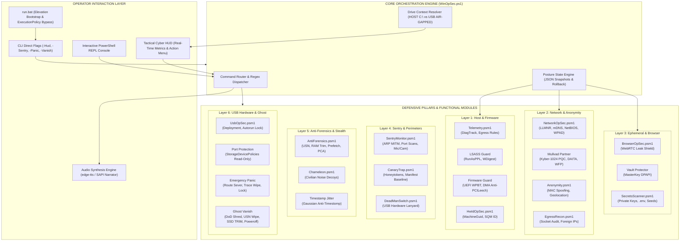
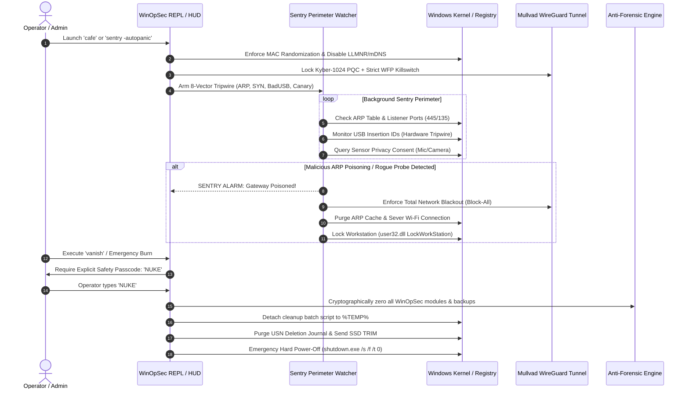

# WINOPSEC v5.0 APEX ARCHITECTURE BLUEPRINT
### Full-Spectrum Defensive OpSec, Tripwire Sentry & Anti-Forensic Execution Topology

---

## 1. High-Level System Architecture Diagram

---

## 2. Operational Dataflow & Signal Routing

---

## 3. Defense-in-Depth Layer Breakdown

### Layer 1: Host Integrity & Kernel Shields
* **LSASS Process Light (RunAsPPL)**: Enforces `AuditLevel = 1` and `RunAsPPL = 1` under `HKLM:\SYSTEM\CurrentControlSet\Control\Lsa`. Blocks Mimikatz and LSASS memory carving even from elevated debuggers.
* **Kernel Paging Protection**: `DisablePagingExecutive = 1` prevents core kernel drivers and sensitive crypto keys from being written to the pagefile on disk.
* **Firmware Defense**: Disables Windows Platform Binary Table (`UEFI WPBT`) execution to neutralize persistent OEM firmware rootkits, and locks `External DMA Guard` against Thunderbolt/PCIe DMA attacks (e.g., PCILeech).

### Layer 2: Network & Anonymity Fabric
* **Protocol Leak Eradication**:
  * Multicast Name Resolution (LLMNR UDP 5355) &rarr; Disabled via policy.
  * Multicast DNS (mDNS UDP 5353) &rarr; Disabled across all network adapters.
  * NetBIOS over TCP/IP (NBT-NS) &rarr; Set to `NetbiosOptions = 2` across all interfaces.
  * WPAD (Web Proxy Auto-Discovery) &rarr; Overridden to static null proxy.
* **Mullvad Partner Ecosystem**: WireGuard configuration enforced with Kyber-1024 post-quantum key exchange, DAITA (Defense Against AI-guided Traffic Analysis) packet padding, and WFP strict outbound killswitch.

### Layer 3: Perimeter Tripwires & Active Deception
* **8-Vector Sentry Monitor**:
  1. *Gateway ARP Integrity*: Watches for duplicate MACs and gateway IP address transitions.
  2. *SYN Port Scan Guard*: Flags unsolicited connection attempts to ports 135 and 445.
  3. *BadUSB Tripwire*: Monitors device registration IDs for stealth HID keyboard emulation attacks.
  4. *Rogue DNS Watcher*: Alerts on unauthorized DHCP-driven DNS resolver drift.
  5. *Mic & Cam Trap*: Detects unauthorized background activation of audio/video capture devices.
  6. *Evil Twin AP Guard*: Detects Wi-Fi BSSID switching or rogue access point cloning.
  7. *Reverse Shell Trap*: Continuously inspects outbound connections originating from command shells (`cmd.exe`, `powershell.exe`).
  8. *Honeytoken Canary*: Drops realistic honeytokens (`passwords_2026.xlsx`, `crypto_wallet_seed.txt`) and tracks `LastAccessTime` divergence against a cryptographic baseline manifest.

### Layer 4: Anti-Forensics & Deception Camouflage
* **Windows 11 Hidden Execution Databases**:
  * Program Compatibility Assistant (PCA): Flushes `PcaAppLaunchDic.txt` and locks the file to 0 bytes (`attrib +r +s +h`).
  * Explorer ShellBags: Purges `BagMRU` and `Bags` keys across `HKCU` and `UsrClass.dat`.
  * Prefetch & BAM: Clears `*.pf` execution traces and resets Background Activity Moderator histories.
* **Civilian Noise Camouflage (`Chameleon`)**: Generates benign academic research papers, recipes, and travel documents with natural timestamps, defeating SANS "Too Clean Machine" anomaly heuristics during forensic inspection.

### Layer 5: USB-Driven Architecture & Ghost Protocol
* **Portable USB Deployment**: Clones the complete portable suite to a removable drive, configures a root launcher, and locks a dummy `autorun.inf` directory (`+s +h +r`) to immunize the drive against USB worms.
* **Hardware Port Protection**: Flips `StorageDevicePolicies\WriteProtect` to enforce read-only status on all connected USB ports, preventing data exfiltration or malware staging.
* **Ghost Self-Destruct (`vanish`)**: Multi-pass random overwrite of all files, detached folder obliteration, NTFS USN Journal wiping (`fsutil usn deletejournal /D`), and storage SSD TRIM optimization prior to immediate shutdown.
